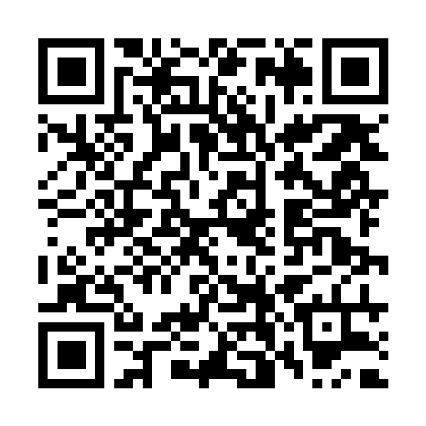

# 眠りの音 — Sleep Sound Generator

雨音・波音・焚き火・ホワイト／ピンク／ブラウンノイズ・バイノーラルビート・ソルフェジオを重ねて、自分だけの睡眠用の音を作るアプリです。
音はすべて Web Audio API でその場で作っています（音声ファイルなし・オフラインで使える）。

- 8 種類の音それぞれに、オン・オフと音量などの調整
- プリセット: 深い眠り・瞑想・雨の夜・焚き火・海辺
- おやすみタイマー（15 / 30 / 60 / 90 分。最後の 30 秒でフェードアウト）
- 端末の言語が日本語なら日本語、それ以外は英語で表示

## Web 版

`index.html` をブラウザで開くだけで使えます（ビルド不要）。
Vercel では `npm run build` で `www/` を作って公開します（`vercel.json`）。

## ファイル

| ファイル | 内容 |
| --- | --- |
| `index.html` / `css/style.css` | 画面 |
| `js/main.js` | 音を作って鳴らす部分・画面の組み立て（Web 版とアプリで共通） |
| `js/i18n.js` | 日本語・英語の切り替え |
| `js/ads.js` | AdMob 広告（アプリのときだけ動く） |
| `js/app.js` | アプリだけの処理（バックグラウンド再生・戻るボタン・広告を出す場面） |
| `js/ads-config.js` / `js/build-info.js` | ビルド時に生成（リポジトリのものは開発用の値） |
| `scripts/build-web.js` | `www/` にまとめる（`--app` でアプリ用） |
| `android/` | Android プロジェクト（Capacitor） |

## Android アプリ

[Capacitor](https://capacitorjs.com/) で Web のファイルをアプリに同梱し、Android アプリにしています（オフラインで使えます）。
構成は techgymjp/jet-fighter の `docs/ANDROID_PORTING.md` と同じです。

- パッケージ名: `jp.techgym.sleepsounds`
- アプリ名: 眠りの音（英語の端末では Sleep Sounds）
- 縦画面固定・全画面
- **画面を消しても鳴り続ける**: 再生中はフォアグラウンドサービス（`PlaybackService.java`）で「再生中」の通知を出し、WakeLock で CPU を止めないようにする。
  通知の「停止」で止まる。Android 13 以降は、最初に再生したときに通知の許可を聞く（許可しなくても再生は続く）
  - ゲームと違い、画面は消えてよい（`FLAG_KEEP_SCREEN_ON` は付けない）。別アプリに切り替えても一時停止しない
- 戻るボタン: 再生中はアプリを裏に回して鳴らし続ける。止まっていればアプリを終了
- 広告（AdMob）。ゲームではないので、ANDROID_PORTING.md の「広告の基本ルール」を次のように読み替えている
  - バナー: 画面の下中央にいつも出す（操作ボタンと重ならないため）
  - 全画面広告（インタースティシャル）: 止まっている状態から鳴らし始めるとき（▶・プリセット・音のスイッチ）。
    一時停止と再開をくり返すたびに出ないよう、前に出してから 3 分は出さない
  - リワード広告: 「🎬 広告を見て 8 時間 広告なし」。最後まで見たときだけ、8 時間バナーと全画面広告を出さない（寝ているあいだ画面に広告が出ない）
  - EU など同意が必要な地域では、画面の下に「広告の設定」
- 画面の下にバージョン（ビルド番号）とプライバシーポリシーへのリンク

ビルドは GitHub Actions（`.github/workflows/android.yml`）で行います。

1. `npm ci` → `npm run build:app`（`www/` に Web ファイルをコピーし、`ads-config.js` と `build-info.js` を生成）→ `npx cap sync android` → `./gradlew assembleDebug`
2. 既定ブランチなら、Release `android-latest` の `sleep-sounds.apk` を差し替え（動作確認用・テスト広告）
   - リリース画面: https://github.com/techgymjp/sleep-sounds/releases/tag/android-latest
   - APK 直接: https://github.com/techgymjp/sleep-sounds/releases/latest/download/sleep-sounds.apk
   - QR コード（リリース画面）:

     
3. GitHub Secrets に署名鍵（`ANDROID_KEYSTORE_BASE64` / `ANDROID_KEYSTORE_PASSWORD` / `ANDROID_KEY_ALIAS` / `ANDROID_KEY_PASSWORD`）があれば、本番広告で署名付き AAB を作り Artifact に上げる

AdMob のアプリ ID は `android/app/src/main/res/values/strings.xml` の `admob_app_id`、
本番の広告ユニット ID は `js/ads.js` の `UNITS.android.production` にあります（空の種類は本番ビルドで出さない。いまはバナーだけ）。
動作確認用 APK はどれもテスト広告、Google Play 用の AAB は本番の広告です。

手元で試すとき: `npm install` → `npm run android:sync` → `npm run android:open`（Android Studio が必要）。
アイコンと起動画面は `icon.svg` から `scripts/make-assets.js` で `assets/` の元画像を作り、`npx @capacitor/assets generate --android` で生成しています。
ストア用の画像と紹介文は `docs/store/`（`listing.md`）にあります。

## ライセンス

著作権はテックジム株式会社に帰属します（All rights reserved）。許可なく複製・改変・再配布すること、Web サイトやアプリ（Google Play、App Store など）として公開・販売すること、名前・アイコン・画像を使うことを禁止します。
テックジムの受講生が学習目的で複製・改変することは許可します（アプリストアでの公開・広告の掲載・販売などの商用利用は不可、著作権表示を残すこと）。詳しくは `LICENSE` を見てください。
